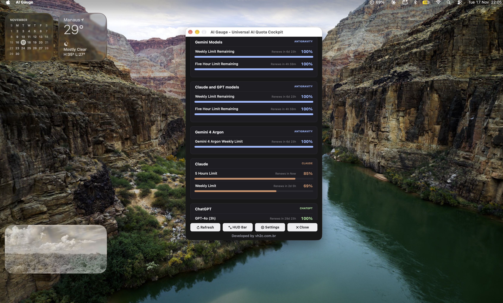
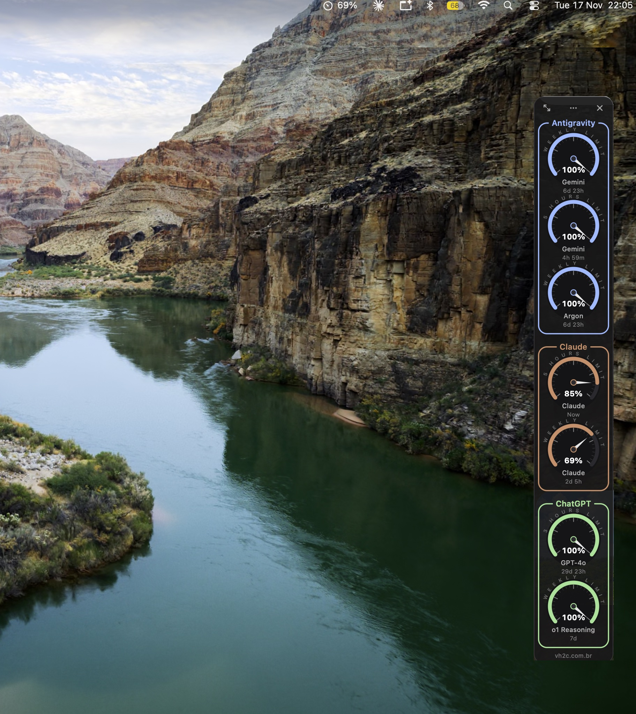
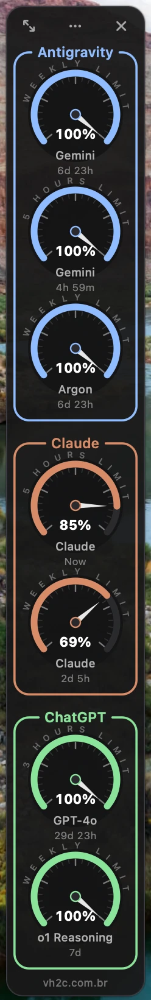
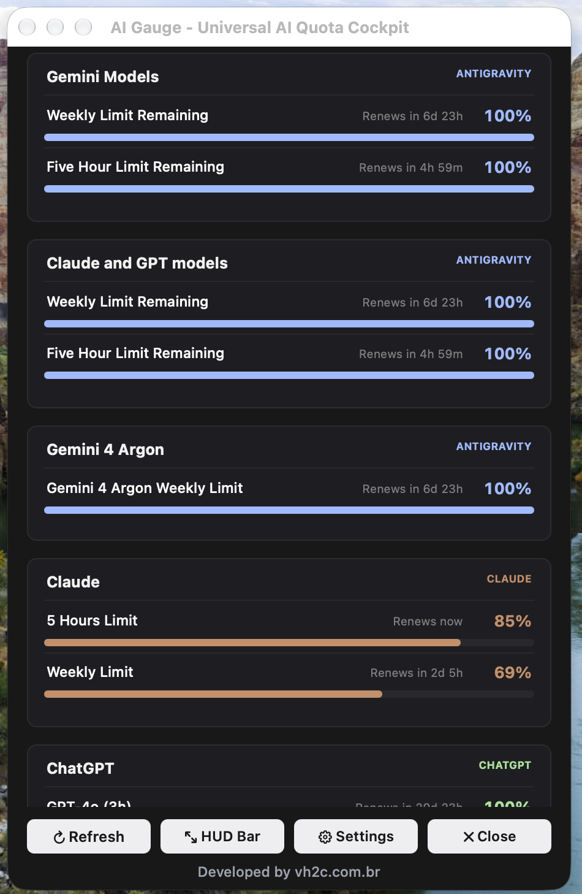

<div align="center">

# ⚡ AI Gauge

### Multi-Platform AI Usage Monitor & Rate Limit Tracker for macOS, Linux & Windows
**Track your Claude, ChatGPT, Cursor, GitHub Copilot, Gemini and Antigravity usage limits in one desktop widget.**

**Developed by [VH2C](https://vh2c.com.br)**

[](https://github.com/vh2c/ai-gauge/releases)
[](https://github.com/vh2c/ai-gauge/releases)
[](https://ai-gauge.vh2c.com.br)
[](LICENSE)
[](#)
[](https://vh2c.com.br)

<br/>


<br/>

**AI Gauge** is a lightweight, high-performance desktop widget (menu bar / floating HUD) that monitors, in real time, the usage quotas, rate limits (RPM/TPM) and reset windows of your AI models on macOS, Linux and Windows. It works **completely independently of any IDE**, bringing **Antigravity**, **Claude**, **ChatGPT**, **Cursor**, **GitHub Copilot (VS Code)** and **Gemini** together in a single panel.

Ever hit the **Claude usage limit**, the **ChatGPT message cap** or ran out of **Cursor fast requests** without warning? AI Gauge shows how much you have left, and when it resets, before it gets in your way.

> 💡 **Zero-Config Detection (Plug & Play)**: If you already use these apps on your computer, AI Gauge detects the local sessions 100% automatically. No need to type tokens or passwords for **Antigravity**, **Claude**, **ChatGPT**, **Cursor** or **Copilot**!

</div>

---

## 📸 Screenshots & Cockpit View

<p align="center">
  <a href="https://ai-gauge.vh2c.com.br" target="_blank">
    
  </a>
</p>
<p align="center"><sub><strong>Desktop Cockpit</strong>: AI Gauge running discreetly alongside Cursor, Antigravity, VS Code, Claude & ChatGPT.</sub></p>

<br/>

<p align="center">
  
  &nbsp;&nbsp;&nbsp;&nbsp;
  
  &nbsp;&nbsp;&nbsp;&nbsp;
  
</p>
<p align="center"><sub>Floating HUD Closeup (left), Compact HUD Strip (center), and Full Metrics Window (right).</sub></p>

---

## 📦 Downloads

No need to compile any code: download the package for your operating system from the **[latest release](https://github.com/vh2c/ai-gauge/releases/latest)**.

| Platform | Download | How to Install |
| :--- | :--- | :--- |
| 🍏 **macOS** | [**AI-Gauge-macOS-vh2c.zip**](https://github.com/vh2c/ai-gauge/releases/latest/download/AI-Gauge-macOS-vh2c.zip) | Easiest: the [one-command installer](#-macos-apple-silicon-with-macos-11--intel-with-macos-13) (no warning). From the browser: drag **AI Gauge.app** to `/Applications` and run the one-time [first-launch command](INSTALL.md#downloaded-it-in-the-browser). Needs **Node.js 18+**. |
| 🪟 **Windows** | [**AI-Gauge-Setup.exe**](https://github.com/vh2c/ai-gauge/releases/latest/download/AI-Gauge-Setup.exe) (recommended) · [ZIP](https://github.com/vh2c/ai-gauge/releases/latest/download/AI-Gauge-Windows-vh2c.zip) | Run the installer, or use the [one-command installer](#-windows-windows-10--11) in PowerShell. If SmartScreen appears: **More info → Run anyway**. Node.js is included. |
| 🐧 **Linux** | [**AI-Gauge-Linux-vh2c.zip**](https://github.com/vh2c/ai-gauge/releases/latest/download/AI-Gauge-Linux-vh2c.zip) | Extract the ZIP and run **`./linux/install.sh`** in a terminal. |

> ⚠️ **About the security warnings.** AI Gauge is open source, but its installers are **not code-signed yet** and the macOS app is **not notarized**, so macOS and Windows may warn you the first time. The step-by-step fix is in the **[Installation Guide (INSTALL.md)](INSTALL.md)**, which also covers verifying checksums, troubleshooting, uninstalling, and **how to have an AI assistant install it for you**.

---

## 🌟 Key Features and HUD Sections

The information in the floating side HUD is grouped by app/provider, each with its own accent color:

1. **`Antigravity`** *(Pastel Blue `#8FBCFF` - dedicated IDE)*:
   - Direct monitoring of the **Google Antigravity IDE** ecosystem (live or headless).
   - **Gemini**: Weekly quota and 5-hour window.
   - **Claude/GPT**: Internal third-party quota (Opus 5.5, Sonnet 5.5, GPT-OSS 120B).
   - **Argon**: Dedicated weekly quota for Gemini 4 Argon WTU.
   - *Authentication:* **Zero-Config** (reads directly from the IDE process/environment).

2. **`Claude`** *(Terracotta Coral `#D78C68` - Anthropic desktop app)*:
   - Monitors your official Claude account and subscription (Pro / Team).
   - **5 Hours Limit**: Rolling 5-hour window of the current session.
   - **Weekly Limit**: Weekly quota with a countdown to renewal.
   - *Authentication:* **Zero-Config** (captured from the macOS Keychain, with automatic refresh of expired tokens).

3. **`ChatGPT`** *(Mint Green `#8AE39A` - OpenAI desktop app)*:
   - Monitors access to your official ChatGPT account (Free, Plus, Pro, Team).
   - **GPT-4o (3h / Active Quota)**: Message window and rate limit.
   - **o1 Reasoning (Weekly)**: Weekly quota for advanced reasoning models.
   - *Authentication:* **Zero-Config** (automatically detects the app session in `~/.codex/auth.json`).

4. **`Cursor`** *(Neon Purple `#A855F7` - Cursor IDE)*:
   - Monitors the quotas of your Cursor subscription (Pro / Business / Fast Requests).
   - **Fast Requests**: Monthly quota of fast requests to premium models (Claude 3.5 Sonnet & GPT-4o).
   - **Monthly Cycle**: Countdown to the renewal of your monthly billing quota.
   - *Authentication:* **Zero-Config** (automatic extraction from Cursor's local storage in `state.vscdb`).

5. **`Copilot`** *(Vibrant Coral `#FF5265` - Visual Studio Code)*:
   - Monitors the status and limits of **Copilot** in VS Code.
   - **Copilot Chat & Model Limits**: Chat message quota and access to Claude 3.5 Sonnet / GPT-4o.
   - **Completions Rate Limits**: Real-time code generation rate limits.
   - *Authentication:* **Zero-Config** (detects the VS Code environment, `gh` CLI tokens or local credentials).

6. **`Gemini`** *(White/Silver `#EBEBEB` - Google AI Studio API)*:
   - Monitoring of direct developer API keys.
   - **Flash RPM & Pro RPM**: Requests-per-minute limits and key status.
   - *Authentication:* Requires an API key (`AIzaSy...`) obtained from [Google AI Studio](https://aistudio.google.com).

---

## ❓ Why AI Gauge?

- **One place for every AI quota:** Claude (Pro/Team), ChatGPT (Free/Plus/Pro/Team), Cursor, GitHub Copilot, Gemini API and Google Antigravity.
- **No setup for most providers:** local sessions are detected automatically (zero-config), with no passwords or tokens to paste.
- **Always visible:** a floating HUD or full window with fuel-style gauges, so you know when to slow down or switch models.
- **Private by design:** your keys, prompts and code never leave your machine. See [Telemetry & Privacy](#-telemetry--privacy).
- **Open source (MIT)** and available for macOS, Windows and Linux.

---

## 🧙‍♂️ Welcome Wizard & Auto-Scan (Onboarding Wizard)

When you install or launch **AI Gauge** for the first time, the smart wizard automatically scans your system:
* **Provider Scan:** Identifies whether **Antigravity**, **Claude** (Claude Code/Keychain) and **ChatGPT** (Desktop session) are already present on your machine.
* **Intuitive Initial Selection:** Shows a clean quick-setup window asking which quotas you want to monitor in your Cockpit.
* **Total Flexibility:** You can enable or disable providers at any time later through **Settings (⌘,)** or the status bar icon.
* **Terminal / CLI Mode:** The install scripts (`install.sh` / `install.ps1`) also include the interactive wizard in the terminal!

---

## 🔋 How to Read the Gauges (Fuel Scale)

All the analog dials in AI GAUGE work like a **battery or fuel gauge**:
* **100%** = Full tank / Quota fully available.
* **0%** = Quota exhausted.

> ℹ️ **Difference from official screens (such as Claude.ai):**
> Apps like Claude express consumption as **% USED** (*e.g. "5% used"*).
> In AI GAUGE, that is equivalent to **95% AVAILABLE**.

* **Green (`#00E699`)**: Healthy quota (50% – 100% remaining).
* **Amber (`#F5A623`)**: Moderate usage (20% – 49% remaining).
* **Red (`#FF4D4F`)**: Low-quota alert (< 20% remaining).

---

## ⌨️ Keyboard Shortcuts

| Shortcut | Action |
| :--- | :--- |
| `Cmd + M` (Mac) / `Ctrl + M` (Linux/Win) | Toggle between **Full Window** and **Floating HUD** |
| `Cmd + O` (Mac) / `Ctrl + O` (Linux/Win) | Toggle HUD orientation (**Vertical** / **Horizontal**) |
| `Cmd + R` (Mac) / `Ctrl + R` (Linux/Win) | Refresh all metrics immediately |
| `Cmd + ,` (Mac) / `Ctrl + ,` (Linux/Win) | Open the **Settings (⚙️)** screen |
| `Cmd + W` / `Esc` | Hide or close the window |

---

## 🚀 Quick Install

> 📘 Full details, checksums, troubleshooting and uninstall steps: **[INSTALL.md](INSTALL.md)**.

### 🍏 macOS (Apple Silicon with macOS 11+ · Intel with macOS 13+)
**One command, no security warning** (checks the SHA-256 checksum, installs and opens the app; run it again to update):
```bash
curl -fsSL https://raw.githubusercontent.com/vh2c/ai-gauge/main/macos/get-ai-gauge.sh | bash
```
Needs **Node.js 18+** (`node -v`); the script tells you if it is missing.

*Or install manually:*
1. **Install Node.js 18+** if you do not have it (check with `node -v`): download the LTS installer from [nodejs.org](https://nodejs.org) or run `brew install node`. Without it, the app cannot collect any quota data.
2. Download [**AI-Gauge-macOS-vh2c.zip**](https://github.com/vh2c/ai-gauge/releases/latest/download/AI-Gauge-macOS-vh2c.zip), extract it and drag **`AI Gauge.app`** to the `/Applications` folder.
3. **First launch:** the app is not notarized by Apple, so macOS blocks the first launch. Run this once in Terminal:
   ```bash
   xattr -cr "/Applications/AI Gauge.app" && open "/Applications/AI Gauge.app"
   ```
   Alternative: try to open the app, then go to **System Settings → Privacy & Security → Open Anyway**. (On recent macOS versions, "right-click → Open" is not enough.)
4. From then on, open it from Spotlight or Launchpad.

*Developers can build from source instead (needs the Xcode Command Line Tools):*
```bash
git clone https://github.com/vh2c/ai-gauge.git
cd ai-gauge/macos
./install.sh
```

---

### 🐧 Linux (Ubuntu, Debian, Fedora, Arch, Mint)
1. Download [**AI-Gauge-Linux-vh2c.zip**](https://github.com/vh2c/ai-gauge/releases/latest/download/AI-Gauge-Linux-vh2c.zip).
2. Extract the archive and run the self-contained script (it downloads a portable Node.js for you):
```bash
unzip AI-Gauge-Linux-vh2c.zip -d AI-Gauge-Linux
cd AI-Gauge-Linux
./linux/install.sh
```
3. Start it from your applications menu (**AI Gauge**) or run `gemini-gauge` in a terminal.

---

### 🪟 Windows (Windows 10 / 11)
**One command in PowerShell** (verifies the checksum, then starts the installer):
```powershell
irm https://raw.githubusercontent.com/vh2c/ai-gauge/main/windows/get-ai-gauge.ps1 | iex
```

*Or install manually:*
**Recommended option (1 click):** download [**AI-Gauge-Setup.exe**](https://github.com/vh2c/ai-gauge/releases/latest/download/AI-Gauge-Setup.exe) and run it. If Windows shows **"Windows protected your PC"**, click **More info → Run anyway** (the installer is not code-signed yet). It already includes Node.js, does not ask for administrator rights, creates the shortcuts and replaces previous versions.

**Alternative option (ZIP):**
1. Download [**AI-Gauge-Windows-vh2c.zip**](https://github.com/vh2c/ai-gauge/releases/latest/download/AI-Gauge-Windows-vh2c.zip).
2. Extract the ZIP (do not run it from inside the ZIP).
3. Double-click **`install.bat`**. No administrator rights or pre-installed Node.js needed: if it is missing, the installer downloads a portable Node.js (~30 MB, one time only, SHA-256 verified).
4. Shortcuts are created on the Desktop and in the Start Menu. A previous version is removed automatically and your settings are kept.
5. To uninstall: **Settings → Apps** (or Start Menu → *Uninstall AI Gauge*).

---

### 🤖 Prefer to have an AI assistant install it?
[INSTALL.md](INSTALL.md#install-with-an-ai-assistant) includes a ready-to-paste prompt with safety rules, for assistants that can run commands on your computer (or to be guided step by step).

---

## 📊 Telemetry & Privacy

AI Gauge talks to its own server for **one reason**: to tell the **FREE** and **PRO** editions apart, check for a **new version**, and show optional notices. Your quota data is read **locally** from your own AI tools and never leaves your computer.

### When does it connect?
- **Once, when the app opens** (restarting it within 10 minutes does not connect again).
- **Once more every 24 hours**, only if the app stays open. It is a plain check and does not count as a new launch.
- There are no timers or background polling in between. Between those moments the app only reads a small local cache.

### What is sent?

| | FREE | PRO |
| :--- | :--- | :--- |
| Random anonymous ID (`machine_id`, created on your machine, no hardware fingerprint) | ✅ | ✅ (so your license is recognised) |
| App version | ✅ | ✅ |
| Operating system and CPU architecture | ✅ | ❌ |
| System interface language (e.g. `pt-BR`, `en-US`), only to choose the notice language and the right donation account | ✅ (stored) | ✅ (used for that request, **not stored**) |
| Server-side: a daily-rotating one-way hash of your IP (no location is derived) | ✅ | ❌ |
| Launch counter and last-seen time | ✅ | ❌ |
| What the server answers | Latest version, notices and the optional promo | Latest version |

For **PRO**, the server stores only the app version, and only when it changes.

**Language:** if the app cannot read your system language (or you use an older version that does not send it), the server assumes **English**. Brazil (Portuguese, or any language with the region set to Brazil, such as `en-BR`) gets notices in Portuguese and the Brazilian donation account; everything else gets English and the international one.

**Donations and PRO licenses:** payments are handled by Stripe. When you pay, the country and state you type in Stripe's checkout are kept with your license so we can see where supporters come from. That is information you give us for the payment, not something derived from your device.

**Never sent, in any edition:** API keys, tokens, prompts, code, projects, which AI tools or providers you use, quota values, or any personal data such as your name or e-mail.

A note on IP addresses: like any web server, ours sees your IP address while handling the request, but it is **not stored with your device record** and it is **never sent to any third party**. For FREE users the server keeps a one-way hash of the IP that changes every day, so it cannot be linked across days. The server **does not derive your country, state or city**. The only case where an IP address is kept is when a request is invalid or abusive (for example a malformed call): it is then held in a block list for a limited time (blocks last 10 minutes, then 24 hours) to protect the server. PRO users are not hashed.

### Promotional messages (FREE only)
If an active promo exists, it appears as a small window **at most once every 6 hours**, starting one minute after the app opens. It is chosen from the data received at the last check, so showing it **needs no extra network request and sends no extra data**. It never opens twice at the same time, even if the computer stays on for days or the app restarts. If there is no active promo, nothing is shown. PRO users never see promos, and FREE users also see a fixed "Help AI GAUGE developers team" banner.

### How to turn it off
Set `"telemetry": false` in `config.json` (`~/.config/UniversalAIQuota/config.json`; on Windows, `%USERPROFILE%\.config\UniversalAIQuota\config.json`).
- The app then **never contacts our server** (only a public GitHub lookup of the latest release version, at the same moments as above).
- You will not receive notices or promos, and a PRO license cannot be recognised, so the app behaves as FREE.

The exact data the app sends is built in [`core/updater.js`](core/updater.js), which is open source. The server code is not public.

---

## 💼 Custom AI Solutions for Business

Need autonomous AI agents, complex workflow orchestration or custom development for your organization?

Get to know **[VH2C](https://vh2c.com.br)** or talk to our engineering team.

---

## 📄 License

Distributed under the **MIT** license. See the `LICENSE` file for more information.  
Developed with ⚡ by **[VH2C](https://vh2c.com.br)**.


